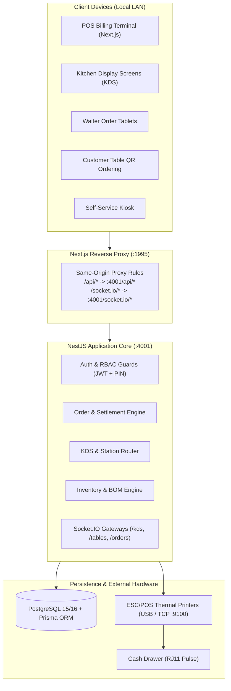
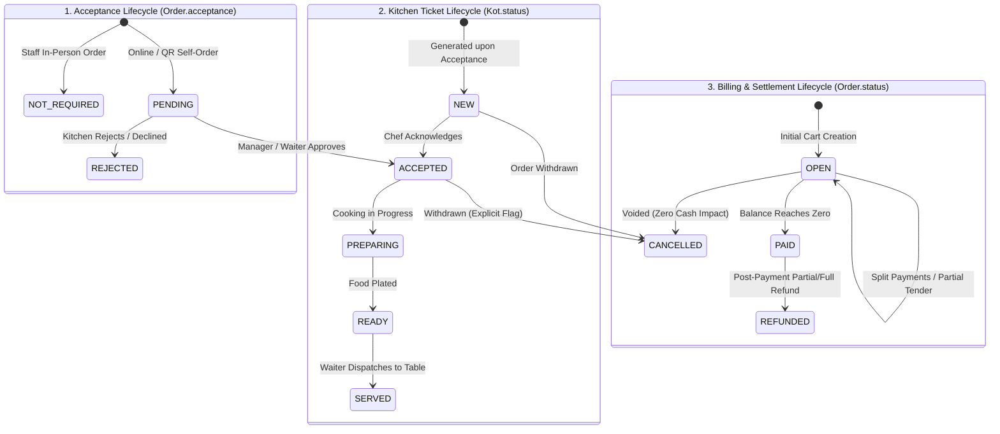
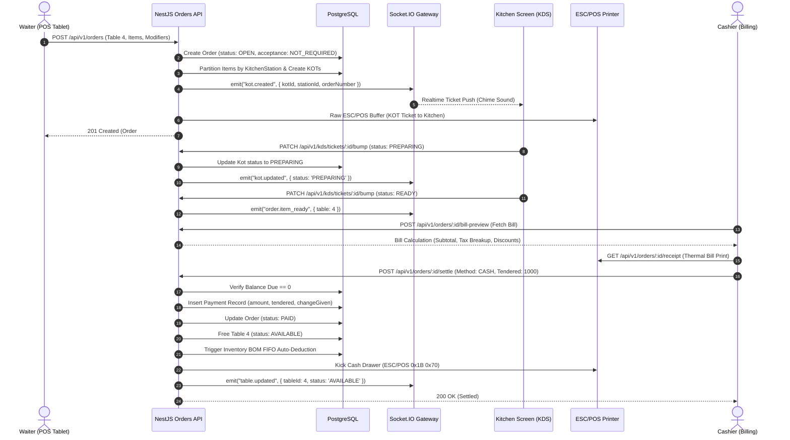
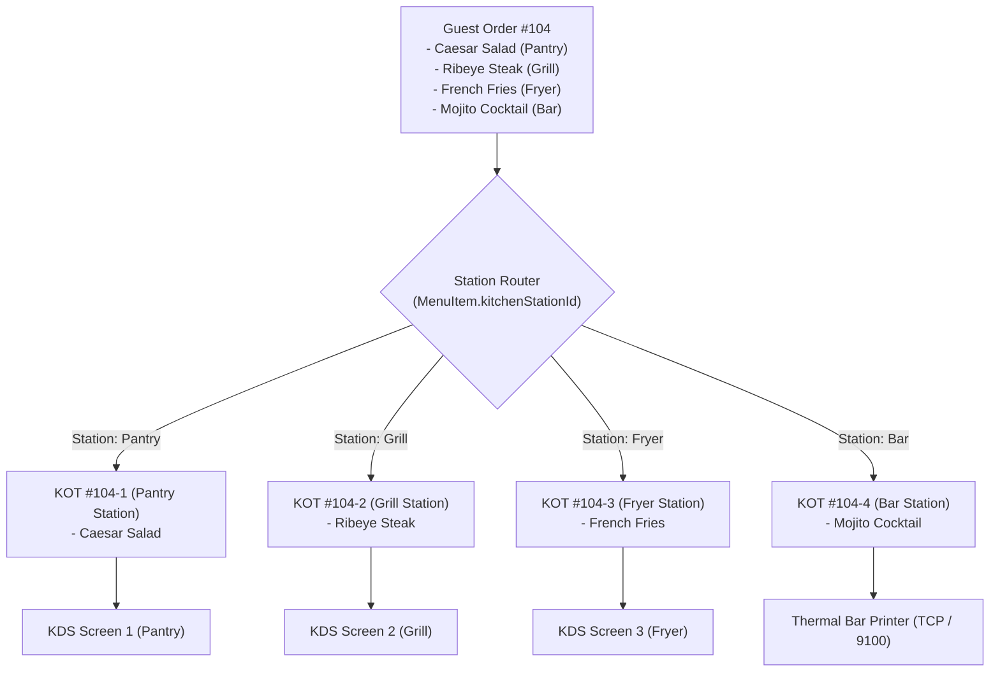
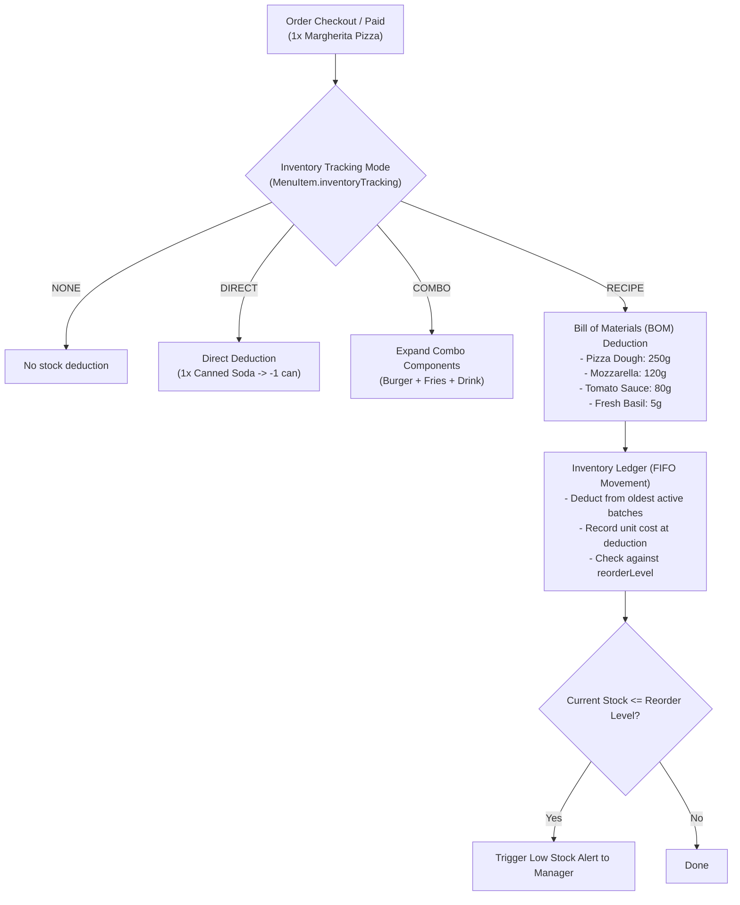
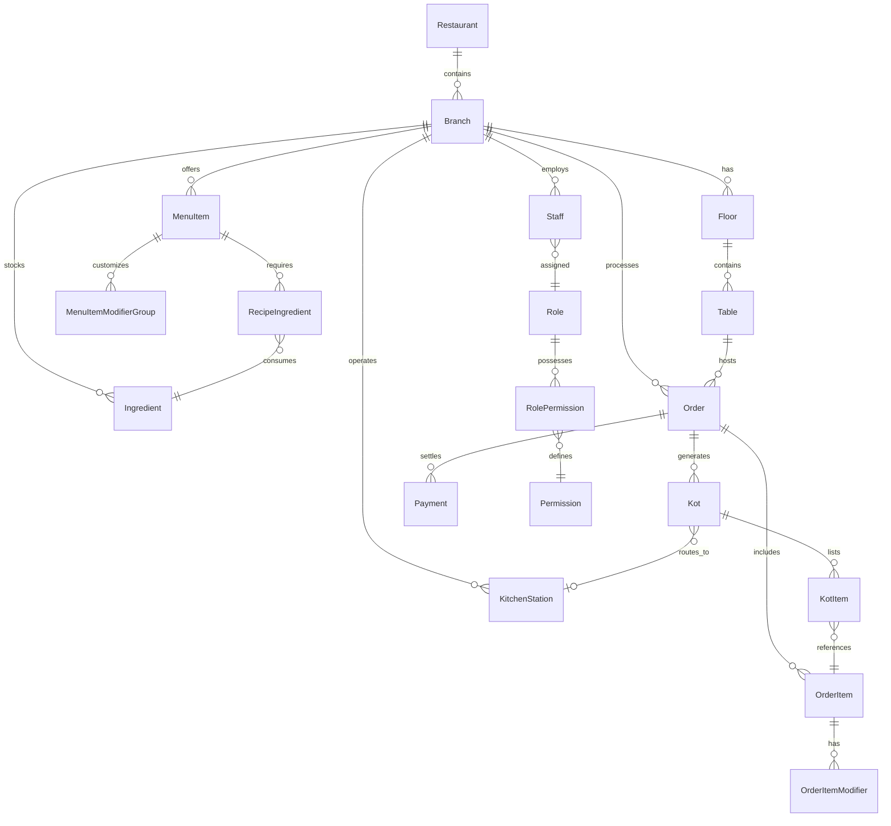
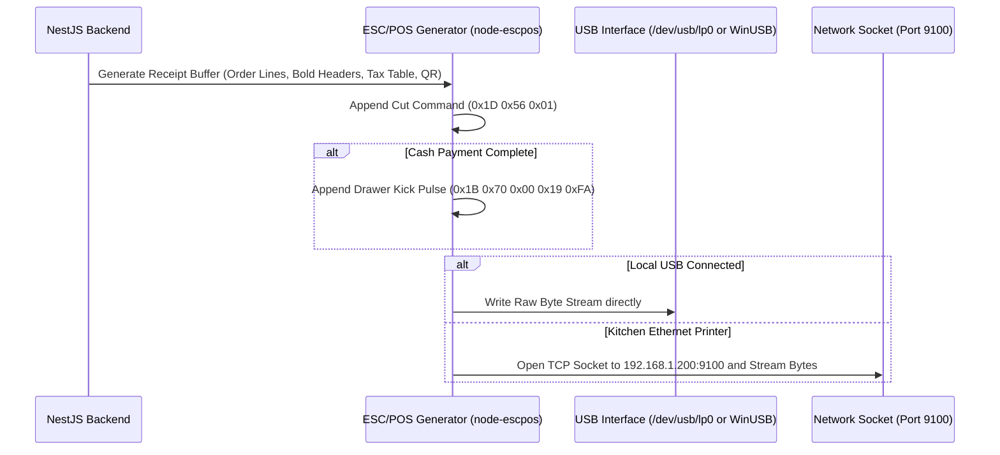
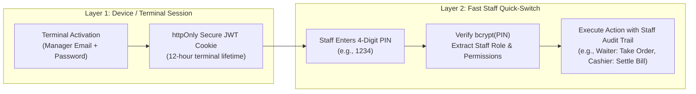

# Enterprise Restaurant POS & Management System
## Architectural Blueprint, Domain Logic, and Data Flow Specifications

---

## 1. Executive Architecture Overview

Building a resilient, production-grade restaurant POS requires a fundamentally different architecture than standard e-commerce or retail systems. Restaurants are fast-paced, high-concurrency environments where network connectivity fluctuates, orders undergo continuous modification, multiple kitchen stations cook in parallel, and financial calculations are subject to strict tax compliance.



### Core Architecture Pillars

1. **Offline-by-Construction on Local LAN**:
   The primary server runs locally inside the restaurant on a dedicated low-power PC or POS box. All tablets, terminals, KDS screens, and customer smartphones connect via the restaurant's local Wi-Fi or Ethernet. If the external internet/WAN drops, 100% of internal operations (order entry, KOT printing, kitchen display, bill settlement, and cash drawer kicks) continue without interruption.
2. **Same-Origin Reverse Proxy Topology**:
   The Next.js frontend on port `1995` proxies all `/api/*` and `/socket.io/*` requests server-side to the NestJS backend on port `4001`. This completely eliminates cross-origin cookie restrictions (`SameSite`, `Secure` over HTTP on local IPs) and prevents session drops in local environments.
3. **Server-Authoritative Computations**:
   The client never calculates discounts, taxes, totals, or inventory changes. Every monetary sum is calculated and verified server-side inside pure, unit-tested pricing functions.

---

## 2. Decoupled Order Lifecycle & State Machine

In food service, an order is **not** a single state. A customer may be eating food that is already served while ordering a second round of drinks, yet hasn't paid a rupee. Conflating kitchen status, acceptance status, and payment status causes state corruption.

The system decouples orders into **three independent, orthogonal state machines**:



### Concurrency and Compare-and-Set (CAS) Protection

To prevent race conditions where two cooks bump the same ticket simultaneously or a cashier checks out an order while a waiter modifies it:
- Ticket updates use **Compare-and-Set (CAS)**:
  ```sql
  UPDATE "Kot" 
  SET "status" = 'PREPARING', "updatedAt" = NOW() 
  WHERE "id" = $1 AND "status" = 'ACCEPTED';
  ```
  If the row was already bumped, the query updates 0 rows and returns HTTP `409 Conflict`, forcing the client UI to refetch current server state.
- Checkouts require an idempotent `requestId` generated by the frontend, ensuring accidental double-clicks do not process duplicate card/cash payments.

---

## 3. End-to-End Data Flow Diagrams

### Flow 1: Full Dine-in Order Lifecycle (Table to Kitchen to Payment)



---

## 4. Kitchen Ticket Splitting & Station Routing Engine

Restaurants separate food preparation across distinct stations (e.g., Cold Pantry, Grill, Fryer, Pizza Oven, Bar). A single guest order containing a Salad, a Steak, and a Mojito must route its components to their respective screens and physical printers.



### The Unassigned Fallback Rule
If an item is not assigned to any station, the system routes it to an **All-Station Fallback View**. If items were hidden from pinned station screens without assignment, unassigned tickets would disappear completely from the kitchen, resulting in lost meals.

---

## 5. Server-Authoritative Settlement & Tax Calculation

Restaurant tax calculations require backward-deduction discipline. In India (GST), the EU (VAT), and Spain (IVA), restaurant menu prices are legally mandated to be **Tax-Inclusive**.

### Mathematical Principles

#### 1. Backing Out Tax from Inclusive Prices
When an item has a menu price of ₹118 with an 18% GST rate:
$$\text{Line Total} = \text{Unit Price} \times \text{Quantity} = 118.00$$
$$\text{Tax Rate Decimal } (r) = \frac{18}{100} = 0.18$$
$$\text{Taxable Base} = \frac{\text{Line Total}}{1 + r} = \frac{118.00}{1.18} = 100.00$$
$$\text{Tax Amount} = \text{Line Total} - \text{Taxable Base} = 118.00 - 100.00 = 18.00$$

Under India GST, the 18% breaks down equally into **CGST 9% (₹9.00)** and **SGST 9% (₹9.00)**.

#### 2. Pro-Rata Discount Scaling (Tax Base Protection)
A critical bug in novice POS systems is applying discounts on the tax-exclusive base or forgetting to reduce taxable liabilities when discounts are granted.

In this architecture, discounts are applied directly against the tax-inclusive subtotal. The tax liability is scaled down **pro-rata**:

$$\text{Tax Scale Factor} = \frac{\text{Subtotal} - \text{Discount Amount}}{\text{Subtotal}}$$
$$\text{Effective Tax Due} = \text{Initial Tax Amount} \times \text{Tax Scale Factor}$$

#### 3. Loyalty Points vs Discounts
- **Discounts** reduce the sale price and therefore **reduce tax liability**.
- **Loyalty Points** are treated as a **form of payment / tender**, not a price cut. Redeeming points does **not** alter the taxable base or the GST payable.

#### 4. Rounding Discipline
Floating-point numbers in JavaScript suffer from IEEE 754 precision issues (e.g. `0.1 + 0.2 === 0.30000000000000004`). All calculations are passed through a strict `round2` function:
```typescript
export function round2(value: number): number {
  return Math.round((value + Number.EPSILON) * 100) / 100;
}
```

---

## 6. Recipe-to-Inventory BOM & FIFO Auto-Deduction Engine



### Cost Accounting: Weighted Average Cost (WAC)
Whenever new stock arrives through a Goods Received Note (GRN):
$$\text{New Cost Price} = \frac{(\text{Current Stock} \times \text{Current Cost}) + (\text{Received Qty} \times \text{Purchase Price})}{\text{Current Stock} + \text{Received Qty}}$$
This guarantees that gross profit margins on menu items remain accurate regardless of supplier price fluctuations.

---

## 7. Database Entity Relationship Model (ERD)



### Key Database Tables

| Table | Purpose | Concurrency / Partitioning Rule |
|---|---|---|
| `Restaurant` | Multi-tenant root account | Root organizational unit |
| `Branch` | Physical restaurant location | All operational queries are scoped by `branchId` |
| `Table` | Dine-in tables with SVG coordinates | Status transitions emit realtime table state |
| `Order` | Order header (Dine-in, Takeaway, Delivery) | Independent `acceptance` and `status` flags |
| `OrderItem` | Snapshot of item at time of order | Freezes price & tax rates; menu edits do not mutate past orders |
| `Kot` | Kitchen Order Ticket per station | Uses CAS optimistic locking on status progression |
| `Ingredient` | Raw inventory tracking | Stores `currentStock`, `unit`, and `costPrice` |
| `RecipeIngredient` | BOM mapping recipes to menu items | Multiplied by order quantity on checkout |
| `Payment` | Multi-tender transaction records | Stores `amount`, `tendered`, and `changeGiven` |
| `AuditLog` | Immutable event ledger | Records all voids, refunds, discounts, and overrides |

---

## 8. Hardware & Device Integration Protocol

### ESC/POS Thermal Printing (80mm & 58mm)
Unlike standard web browsers that trigger an OS print dialog, a real POS must silently print to USB or Ethernet thermal printers without human intervention.



### Dynamic UPI QR Generation (India)
The system formats standard UPI deep-link strings:
```
upi://pay?pa=restaurant@upi&pn=NodedrBistro&am=480.00&cu=INR&tn=Order-104
```
This is transformed into a high-contrast QR code rendered on the customer-facing bill or secondary screen, allowing instant settlement without third-party card terminal monthly rentals.

---

## 9. Security, Staff RBAC & Session Design

### Dual-Layer Authentication



1. **Terminal Session**: Kept alive via an `httpOnly` JWT session cookie.
2. **Staff PIN Switch**: Multiple waiters use the same physical tablet without repeatedly typing complex email/passwords. Every void, discount, or payment logs the exact `staffId` responsible in the `AuditLog`.

---

## 10. Blueprint: Step-by-Step Implementation Roadmap

If you are developing a restaurant POS of this caliber from scratch, execute in these phased stages:

```
┌────────────────────────────────────────────────────────────────────────┐
│ Phase 1: Foundations & Schema                                          │
│ - Initialize pnpm monorepo with Turborepo (`backend`, `web`, `types`)   │
│ - Design Prisma schema with Restaurant -> Branch multi-tenancy         │
│ - Implement JWT + bcrypt PIN auth with RBAC Permission guards          │
├────────────────────────────────────────────────────────────────────────┤
│ Phase 2: Menu, Pricing & Tax Math                                      │
│ - Create Menu catalog (Categories, Items, Modifiers, Combo components) │
│ - Write pure arithmetic pricing module (Tax-inclusive GST/VAT engine)  │
│ - Build order placement and server-side bill preview endpoints         │
├────────────────────────────────────────────────────────────────────────┤
│ Phase 3: Kitchen Routing & Realtime KDS                                │
│ - Implement Socket.IO gateways for realtime state streaming            │
│ - Build KOT splitting algorithm based on kitchen stations              │
│ - Build KDS Kanban screen with bump CAS logic and audio chimes         │
├────────────────────────────────────────────────────────────────────────┤
│ Phase 4: POS Billing Interface & Floor Plan                            │
│ - Implement Next.js POS touch billing grid with cart & modifiers       │
│ - Build interactive floor layout with table status lifecycles          │
│ - Add bill merging, table transfers, and multi-tender settlement       │
├────────────────────────────────────────────────────────────────────────┤
│ Phase 5: Inventory BOM & Costing                                       │
│ - Build ingredient catalog with unit conversions                       │
│ - Link Recipe BOM to menu items with direct & recipe tracking modes    │
│ - Execute FIFO stock deduction and Weighted Average Cost updates       │
├────────────────────────────────────────────────────────────────────────┤
│ Phase 6: Hardware, Printing & Offline Hardening                        │
│ - Implement ESC/POS raw socket printing (USB & TCP :9100)              │
│ - Add cash drawer pulse signals & dynamic UPI QR codes                 │
│ - Package with Docker Compose and Windows service manifests            │
└────────────────────────────────────────────────────────────────────────┘
```
